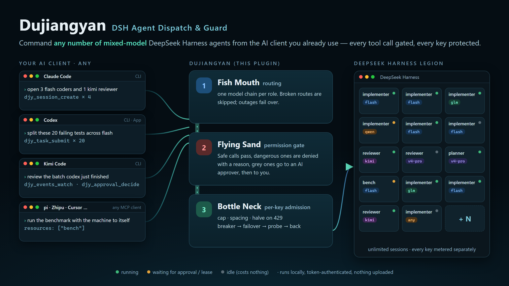
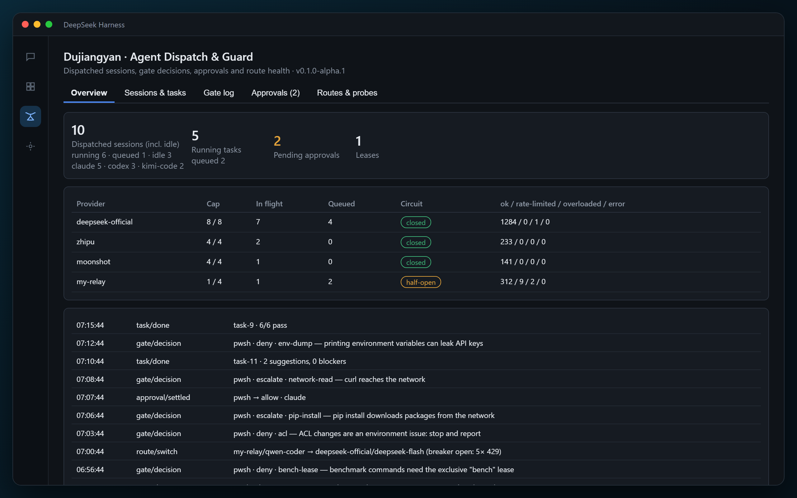
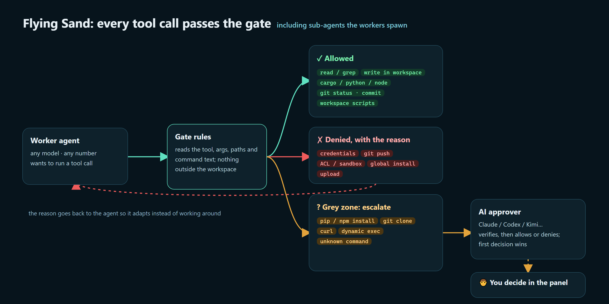
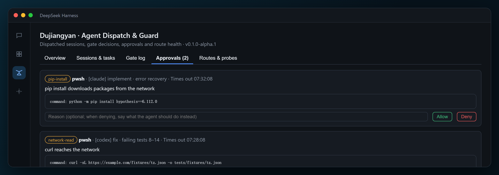
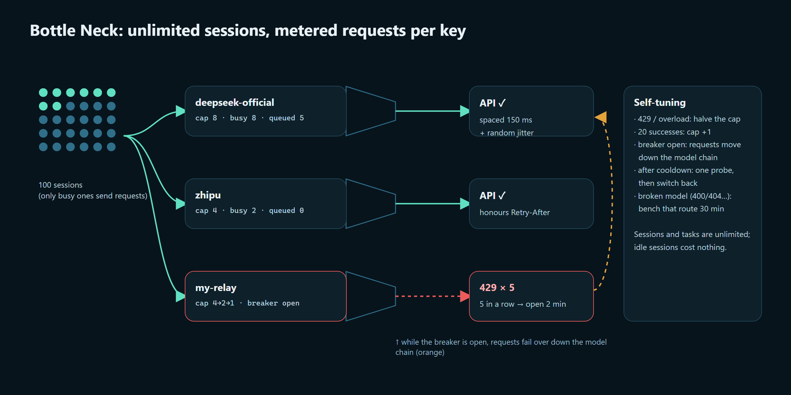
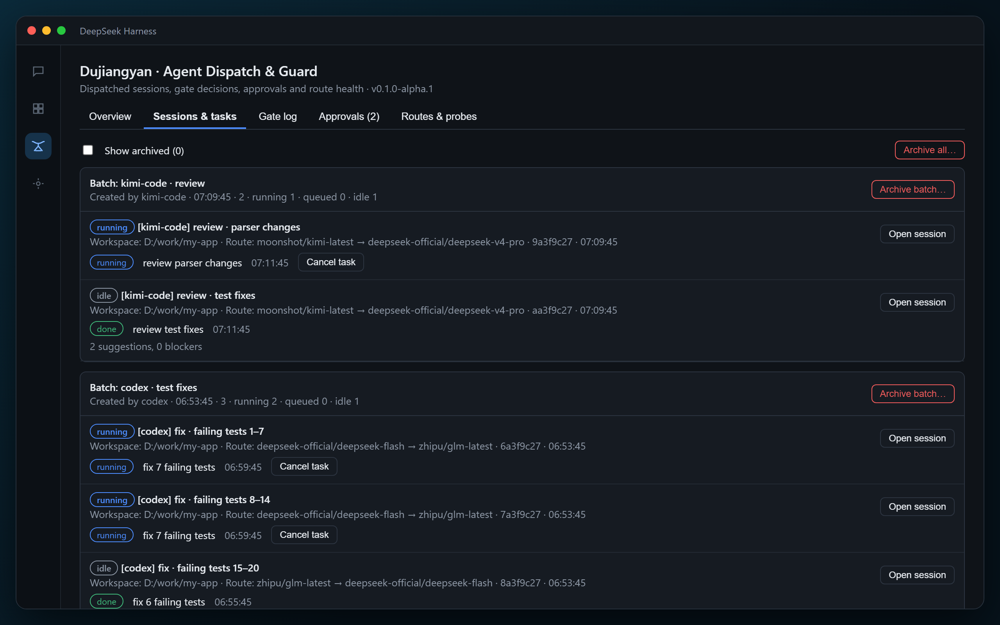
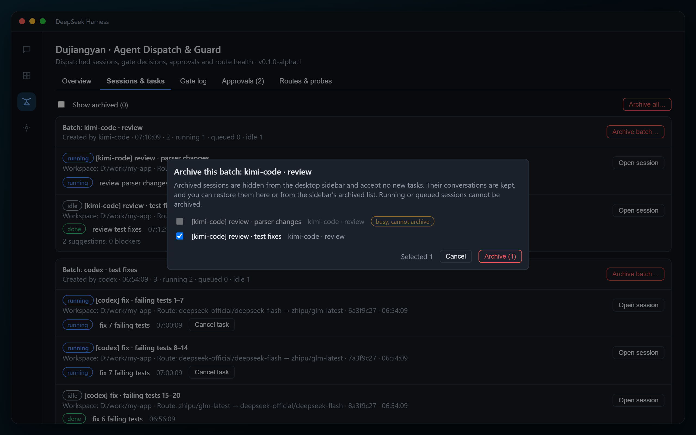
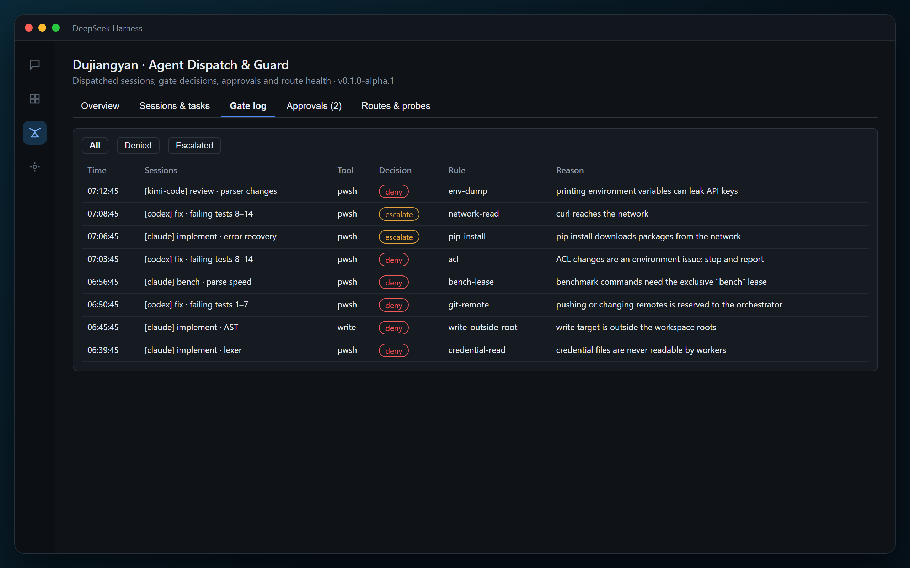
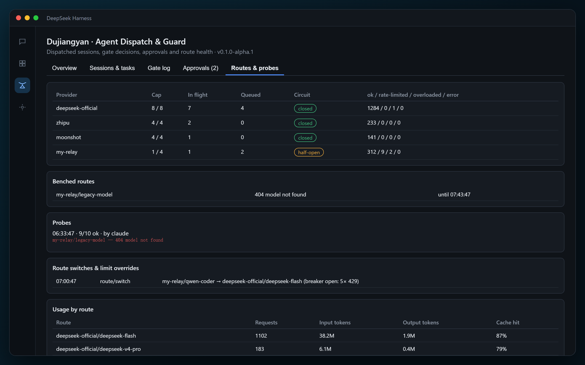

<p align="right"><strong>English</strong> · <a href="./README.zh-CN.md">简体中文</a></p>

<p align="center">
  
</p>

<p align="center">
  <a href="https://github.com/klinkdev2026/dsh-dujiangyan-dispatch/actions/workflows/ci.yml"></a>
  
  = 0.2.1-rc.2">
  
  
  <a href="./LICENSE"></a>
</p>

<h3 align="center">Let Claude Code, Codex, Kimi Code… command a whole DeepSeek Harness legion.<br>Every tool call goes through the gate; no API key gets flooded.</h3>

---

Say this in your AI client:

> Open 3 coders and 1 reviewer on a different model, then give me a combined summary.

**Dujiangyan** starts those agents inside the **DeepSeek Harness desktop app** you already run, and takes care of everything that makes this hard:

| | |
|---|---|
| 🧭 **Any client can command** | Claude Code, Codex, Kimi Code, Zhipu, pi, Cursor… anything that speaks MCP can dispatch work, follow progress and approve calls |
| 🌊 **Any number, any model** | No session cap. Each role gets a model chain (DeepSeek, Kimi, GLM, Qwen, any OpenAI-compatible gateway); a broken model is skipped automatically |
| 🛡️ **Every tool call is gated** | Safe calls pass, dangerous ones are denied with a reason, only grey ones are held: optional AI judges first, then you, with full context. Sub-agents the workers spawn are gated too |
| 🚰 **Per-key admission** | Each key gets its own concurrency cap, spaced sends, automatic narrowing on 429, a circuit breaker with failover, and a return to the preferred model once it recovers |
| 🔒 **Exclusive resources** | A benchmark holds the machine to itself; other agents' builds wait instead of stealing CPU (quiet mode) |
| 👀 **Nothing waits silently** | A "Dujiangyan" panel in the desktop sidebar shows sessions, tasks, gate log, approvals and route health; aging approvals and stalled tasks raise alerts and desktop notifications |

<p align="center">
  
  <br><sub>The Dujiangyan panel in the desktop app (demo data): 10 sessions from 3 clients, concurrency and breaker state for 4 providers, recent gate decisions</sub>
</p>

## Dams fail. Dujiangyan doesn't.

Most agent permission systems are **dams**. They block everything and ask the human, again and again, hundreds of times a day. Sooner or later the human gives up and runs with `--dangerously-skip-permissions`. The dam bursts, and the result is worse than having no dam at all: no checks, and a habit of clicking "yes".

**Dujiangyan** is an irrigation system in Sichuan. It was built over 2,200 years ago, it still runs today, and it has no dam. It does not block the Min River. It **divides** it:

| Part | At Dujiangyan | Here |
|---|---|---|
| **Fish Mouth** | A levee that splits the river into two channels | **Routing**: each role has a model chain; requests take the first healthy model, and a tripped breaker fails over down the chain |
| **Flying Sand Weir** | On the bend, sand is thrown out while the main flow passes | **The gate**: safe calls pass on their own, dangerous ones are denied with a reason the agent can act on, only the grey ones are lifted out for review |
| **Bottle-Neck** | Controls how much water enters the plain | **Per-key admission**: adaptive concurrency, spacing, narrowing on 429, a circuit breaker |

The old rule of the weir keepers is *"dig the channel deep, keep the weir low"* (深淘滩，低作堰). Intervene as little as possible. Never fight the agent's productivity. Only divert what would flood the fields: your keys and quota, your money, your machine, your files, and your attention.

### What makes the approval different

- **Every tool call is gated**, including the sub-agents a worker spawns and sandbox escalations requested from inside a tool.
- **A denial is advice, not a wall.** The worker gets the reason (for example "write outside the workspace" or "use the bench lease") and adapts instead of working around the gate. A worker that keeps hitting denials is paused by a deny breaker.
- **Grey calls can go to AI judges first (opt-in).** The judges must all agree, and there are two by default: unanimous allow allows, unanimous deny denies, anything else goes to a human with every opinion attached. The call is fenced as data with a random marker, so prompt-injection text inside it changes nothing. Secrets are redacted, and each session has a judgment budget. Network and outward calls, anything outside the workspace, encoded commands and sandbox widening are **never** judged by AI.
- **The human approver gets full context**: the task, the worker's own explanation, the call's description, the earlier gated calls of the task, and an "Open session" button to read the whole transcript.
- **Nothing waits silently.** A watchdog tells the waiting worker to hold the call, raises alerts as an approval ages, reports stalled tasks, an absent orchestrator and failing AI judges, and the panel shows desktop notifications. At the timeout the call is denied with "resubmit unchanged", instead of turning into a confusing desktop prompt.
- **Quiet mode** keeps benchmarks clean: while one task holds the `bench` lease, heavy builds and tests from other sessions wait.
- **Your own rules, hot-reloaded.** Personal allow/deny patterns, hints, facts and AI settings live in `~/.dsh/dujiangyan/local-rules.json` and apply on save. No restart, no release. Workers cannot write that file.

> **Other tools build dams, and dams fail. This one builds a Dujiangyan.**

## Two halves, one install

| | 🏯 **The DSH half: plugin** | 🤖 **The agent half: MCP server** |
|---|---|---|
| For | You, inside the DeepSeek Harness desktop app | Your AI client (Claude Code, Codex, Kimi Code…) |
| Does | Gates every tool call, per-key admission, model routing, leases, watchdog; the review panel in the sidebar | 23 `djy_*` tools to open sessions, dispatch and steer tasks, follow progress, approve, manage rules and probe routes; plus an agent-facing `CONNECT.md` |
| Runs | Inside the desktop app's process | Same process, on `127.0.0.1:8790/mcp`, token-authenticated |

It is one package on purpose: the MCP server needs the plugin's hooks to create sessions, intercept calls and meter requests, so both halves must live in the same process.

## Contents

- [Dams fail. Dujiangyan doesn't.](#dams-fail-dujiangyan-doesnt)
- [How it differs](#how-it-differs)
- [Quick start](#quick-start)
- [Flying Sand Weir: the permission gate](#flying-sand-weir-the-permission-gate)
- [Bottle-Neck: admission control](#bottle-neck-admission-control)
- [Fish Mouth: multi-model routing](#fish-mouth-multi-model-routing)
- [Working with workers](#working-with-workers)
- [Desktop panel](#desktop-panel)
- [Platforms and clients](#platforms-and-clients)
- [Configuration](#configuration) · [MCP tools](#mcp-tools) · [Security](#security) · [Troubleshooting](#troubleshooting)
- [Roadmap](#roadmap) · [Build from source](#build-from-source) · [Acknowledgements](#acknowledgements)

## How it differs

The DeepSeek Harness community already has excellent multi-agent plugins. Dujiangyan does not build another "captain" inside DSH; it solves a different problem: **letting external AI clients command DSH safely**.

| | **Dujiangyan** | dsh-agent-teams | dsh-crew | dsh-harness-mcp-server |
|---|---|---|---|---|
| Who commands | **Any MCP client** (Claude Code, Codex, Kimi Code…), several at once | A captain session inside DSH | Claude / Codex | Any MCP client |
| Number of agents | **Unlimited**; requests are metered at the admission layer | Up to 8 members by default (configurable) | — | Unlimited |
| Multiple models | ✅ Model chain per role, broken routes skipped, failover | ✅ Per-member model | — | — |
| Gate on every tool call | ✅ Allow / deny with reason / escalate, sub-agents included | Per-member tool policy (documented as not an authorization boundary) | ❌ | ❌ |
| Approvals | ✅ Optional AI judges (must agree), then you with full context | Member calls that need approval are auto-rejected | ❌ | ❌ |
| Per-key admission, 429 narrowing, breaker failover | ✅ | ❌ | ❌ | ❌ |
| Exclusive leases, quiet mode | ✅ | ❌ | ❌ | ❌ |
| Authentication | ✅ Loopback + bearer token + CSRF guard | — | ❌ Unauthenticated HTTP | ❌ |
| Task DAG, member messaging | ❌ (left to the commanding agent) | ✅ Its strength | — | — |
| Platforms | Windows / macOS / Linux | Cross-platform | POSIX only | Cross-platform |

> They complement each other: dsh-agent-teams excels at DAG-style teamwork inside DSH; Dujiangyan turns DSH into a compute legion that outside agents can drive safely.

## Quick start

### 1. Install

> ⏳ **npm release in progress.** Once published, open **Plugins → Add plugin** in the desktop app and enter `dsh-dujiangyan-dispatch`. Until then, use the command line below or [build from source](#build-from-source).

**Command line** (first **quit the desktop app completely**, including the tray icon):

```powershell
# Windows
& "$env:LOCALAPPDATA\Programs\DeepSeek Harness\resources\runtime\cli\bin\dsh.cmd" plugin --profile desktop add github:klinkdev2026/dsh-dujiangyan-dispatch
```

```bash
# macOS / Linux: use resources/runtime/cli/bin/dsh inside the desktop app's install directory
<install dir>/resources/runtime/cli/bin/dsh plugin --profile desktop add github:klinkdev2026/dsh-dujiangyan-dispatch
```

> Use the `dsh` bundled with the desktop app. A globally installed npm `dsh` cannot manage the desktop profile.

### 2. Set the workspace (required)

Append this to `~/.dsh/profiles/desktop/cordis.patch.yml` to name the directories agents may write to:

```yaml
- id: dujiangyan-dispatch
  name: dsh-dujiangyan-dispatch
  config:
    workspaceRoots:
      - '/home/me/my-project'     # or 'C:\work\my-project' on Windows
```

Without `workspaceRoots`, every session is refused. Restart the desktop app; a **Dujiangyan** icon appears in the sidebar.

### 3. Connect your AI client

On start, the plugin writes an **agent-facing connection guide** to `~/.dsh/dujiangyan/CONNECT.md`. In the client you use (Claude Code, Codex, Kimi Code, Zhipu, pi…), tell its agent:

> Read `~/.dsh/dujiangyan/CONNECT.md` and connect your MCP client to Dujiangyan (server name djy) as it describes. Do not show the token. When done, call djy_status and tell me the version.

The agent configures its own client in that client's format and writes the token only into the configuration. For manual setup and verified client configs, see **[docs/CONNECT.md](docs/CONNECT.md)**.

### 4. Dispatch your first task

> Use djy to open an implementer session in /home/me/my-project, list the project structure and write NOTES.md.

The agent reads `djy_guide`, creates the session, submits the task, follows progress and handles approvals. Open the **Dujiangyan** panel to watch.

> 💡 **Sessions are long-lived workers; do not close one after each task.** Tasks on a session run in order and keep context. For follow-up work, find an existing session with `djy_session_list` and reuse it.

## Flying Sand Weir: the permission gate

<p align="center"></p>

The gate applies only to **sessions dispatched by Dujiangyan and their sub-agents**. Sessions you open by hand are unaffected.

| Tier | Contents |
|---|---|
| ✅ **Allowed** | Reads and searches; writes and edits inside the session's write scope; builds and runs (`cargo`, `python`, `node`, `cmake`…); local git (`status/diff/add/commit`); read-only shell commands; the workspace's own scripts |
| ⛔ **Denied, with the reason** | Writes outside the workspace or outside the session's write scope; reading credential files or printing key-bearing environment variables; global or system installs; registry and `setx`; **ACL, integrity-label or sandbox changes** (environment issues belong to you); `git push` and remote changes; uploads; `run_code` (its body bypasses the gate); agents spawning their own sub-agents; plugin or Harness configuration (including `local-rules.json`); benchmarks without the bench lease |
| ❓ **Held for approval** | Everything else: network access, `pip/npm install`, `git clone`, dynamic code execution, deletes with unresolvable targets, unknown commands |

**Who decides a held call.** The first decision wins, and the audit log records who made it:

1. **AI judges** (if enabled, and only for workspace-confined calls; see below);
2. **the connected AI client** (the orchestrator), which should verify independently rather than trust the worker;
3. **you**, with one click in the panel.

**On timeout** (15 minutes by default) the call is denied with "resubmit the same call unchanged", and the host's follow-up sandbox prompt for that call is rejected, so a refused call is never approved by accident as a sandbox escalation. Set `fallbackToHuman: true` to hand timed-out root-session calls to the desktop's own prompt instead.

**Deny breaker.** Three gate or AI denials in a row (or 6 of the last 10 verdicts) pause the task as `needs_attention`, so a worker that keeps rephrasing a refused action stops burning turns. Denials by you or the orchestrator are guidance and do not count.

**Write scope.** Each session may write only inside its own scope: by default its working directory when that is a subfolder of a root. Workers that share a root cannot overwrite each other.

### AI approval: two judges must agree (opt-in)

Off by default. When on, a held call that stays inside the workspace (an unknown command, a dynamic target, an inline script…) goes to model judges before anyone else:

- **The judges must all agree.** Unanimous allow allows, unanimous deny denies. A split, a "human" answer, an error or a timeout leaves the call pending for a human, with each judge's opinion attached.
- **No model is assumed.** Unless you set `aiApproval.judges`, two judges are taken from your own roster: the reviewer route, then the planner, then the implementer. **Two judges from different vendors are recommended**: a split is what keeps one model's blind spot from deciding alone.
- Judges are asked in order and stop at the first answer that can no longer end unanimous, so put the fastest judge first.
- **Hardened input.** Everything the worker wrote is placed between two markers carrying a random code, and the judge is told never to follow text inside them. Secrets are redacted and long fields are clipped.
- **Budget.** At most 20 judgments per session in any 10 minutes (configurable); over budget, the call waits for a human.
- **Never judged by AI:** network and outward calls (fetch, web search, git network, package installs, MCP tools), anything outside the workspace roots, encoded commands, loader-environment changes, sandbox widening, truncated calls, and every deny.
- Judges are probed at start; a judge that keeps failing raises a critical alert ("every escalation now needs a human"). Turn AI approval on or off at run time with `djy_ai_approval_set`.

### Nothing waits silently

| After | What happens |
|---|---|
| 1 min pending | The worker is told to keep the call pending and not to rewrite it |
| 3 min / 8 min pending | Warn / critical alert in the panel, the event log and a desktop notification |
| No MCP client call for 3 min while approvals wait | "Orchestrator absent" alert: decide them in the panel |
| 10 min without activity | The task is reported as stalled (known long waits such as background jobs or quiet mode are excluded) |

All of this also appears in the `health` block of `djy_status`.

<p align="center"></p>

## Bottle-Neck: admission control

<p align="center"></p>

**Sessions, tasks and request concurrency are three different things:**

- **Sessions**: how many workers exist. **Unlimited**; idle sessions cost nothing.
- **Tasks**: how much work is queued on each session. **Unlimited**; tasks on one session run in order.
- **Request concurrency**: how many requests hit one provider at the same moment. **Only this layer needs control.**

So 100 sessions can work at once: every request passes the Bottle-Neck, which admits as many as each key can take. At personal scale the real bottleneck is your own key; gateway keys often allow only 3–5 concurrent requests. Defaults:

- Concurrency cap per provider: `deepseek-official` 8, any other provider 4. Set these to your keys' real limits.
- On 429 or overload the cap halves; after 20 consecutive successes it grows by one.
- `Retry-After` is honoured when the provider sends it; requests are spaced 150 ms apart plus up to 250 ms of random jitter.
- Five rate limits or overloads in a row open the breaker for 2 minutes: requests move down the model chain; after the cooldown one probe request goes through, and on success traffic returns to the preferred model.
- RPM windows and staggered warm-up are off by default and can be enabled.

**Bench lease and quiet mode.** A task submitted with `resources: ["bench"]` holds the machine. Benchmark commands are denied without that lease. While it is held, heavy commands from other sessions (`cargo build/test/…`, `npm/pnpm/yarn test/build`, plus your own patterns) wait, even after an approval. After 30 minutes they are held for approval as `quiet-timeout`.

## Fish Mouth: multi-model routing

Each role has a model chain; earlier entries win:

```yaml
roster:
  implementer:
    - { provider: deepseek-official, model: deepseek-flash }
    - { provider: my-gateway, model: qwen-coder }          # fallback
  reviewer:
    - { provider: another-vendor, model: their-model }     # a different vendor reviews
    - { provider: deepseek-official, model: deepseek-v4-pro }
```

- Providers and models are the ones already configured in your desktop app; no keys are configured twice. List them with `djy_models`.
- `djy_routes_probe` checks each model with a tiny real request. A model that a gateway lists but cannot serve (for example an API dialect mismatch) is benched for 30 minutes and sessions skip it.
- Deterministic errors at run time (400/401/403/404/422, except context-length 400s) bench the route, and the current step retries on the next model in the chain.

## Working with workers

- **Task prompts carry a footer**: the working rules, an environment-facts block (free disk space measured at task start, known sandbox behaviour, your own facts from `local-rules.json`) and a **narration rule**: before each tool call the worker writes one sentence on what it is about to do and why. Held calls are approved from that text.
- **Steer a running worker** with `djy_session_steer`: the correction arrives at its next model step instead of waiting for the turn to end. `djy_approval_decide` takes an optional `note` that is steered to the worker along with the decision.
- **Workers do not hang on questions.** A worker that asks the user something ends its task as `needs_input`; nothing is chosen on its behalf. List them with `djy_questions_list` and answer in a follow-up task on the same session.
- **Restarts.** After a desktop restart, idle sessions resume with their route and permission preset. Tasks cut by the restart end as `interrupted` (not `done`): inspect the workspace and resubmit what is left. The event stream carries an `epoch`; after a restart `djy_events_watch` returns `reset: true`, so watchers drop their old cursor.

## Desktop panel

After installation the desktop sidebar gets a **Dujiangyan** entry with five tabs and a health banner:

| Tab | Contents |
|---|---|
| **Overview** | Sessions (by creator), running tasks, pending approvals, leases; per-provider concurrency, queue and breaker state; recent events |
| **Sessions & tasks** | Grouped by **batch** (one client run per batch, or a name you choose); each session's creator, model chain, tasks, result summaries and open issues; open a session or cancel a task in one click |
| **Gate log** | Every denied or escalated tool call and why, filterable |
| **Approvals** | Held calls with their context (task, the worker's explanation, earlier calls) and AI opinions: Allow or Deny, optionally with a reason, or "Open session" to read the transcript |
| **Routes & probes** | Provider health, benched routes, probe results, route switches, usage and cache-hit rate per model |

<table>
<tr>
<td width="50%"><br><sub>Sessions & tasks: grouped by batch, with each session's model chain</sub></td>
<td width="50%"><br><sub>Archive by batch: confirmed in a dialog, busy sessions excluded, always restorable</sub></td>
</tr>
<tr>
<td width="50%"><br><sub>Gate log: what was stopped and why</sub></td>
<td width="50%"><br><sub>Routes & probes: breakers, benched routes, usage and cache hits</sub></td>
</tr>
</table>

- **Health banner and notifications**: watchdog alerts (aging approvals, stalled tasks, failing AI judges, absent orchestrator) show at the top of the panel, and each alert raises one desktop notification.
- **Archiving**: each batch has "Archive batch…", and a separate "Archive all…" button preselects nothing. It uses the desktop's own archive, so the sidebar stays in sync and everything can be restored.
- Sessions you archive in the sidebar are marked "archived" in the panel, offer only Restore, and accept no new tasks.
- The panel talks to the plugin through the desktop's own login session; no token is involved and other programs cannot impersonate it.

> Screenshots are rendered from the real panel component with demo data.

## Platforms and clients

The plugin is plain JavaScript running in DeepSeek Harness's bundled Node runtime. **Nothing else to install**, no native modules.

| Platform | Status |
|---|---|
| Windows 10 / 11 | ✅ Fully accepted on the real desktop app: all three gate tiers, approvals, bench lease, audit, panel; concurrent sessions across several providers; 429 classification, interplay with Harness's own retries, breaker failover |
| Linux | 🟡 Platform logic (paths, bash command rules) is unit-tested and CI runs on Linux; a real-desktop smoke test is pending |
| macOS | 🟡 Same as Linux |

| Client | Status |
|---|---|
| Claude Code (CLI) | ✅ Verified: dispatch, progress and approvals end to end |
| Codex CLI | ✅ Verified: session creation, task dispatch, progress and results |
| Kimi Code | ✅ Connection verified |
| Codex desktop app | 🟡 Shares `~/.codex/config.toml` with the CLI; not tested yet |
| Other MCP clients | Need "HTTP MCP server + custom headers"; see [docs/CONNECT.md](docs/CONNECT.md) |

## Configuration

There are two places:

- **The profile** (`config` of the `dujiangyan-dispatch` row in `cordis.patch.yml`): the stable base. Changes need a desktop restart. Everything except `workspaceRoots` is optional.
- **`~/.dsh/dujiangyan/local-rules.json`**: your personal, hot-reloaded layer (see below).

| Field | Default | Meaning |
|---|---|---|
| `workspaceRoots` | `[]` | **Required.** Directories agents may write to |
| `host` / `port` | `127.0.0.1` / `8790` | MCP listen address |
| `stateDir` | `~/.dsh/dujiangyan` | Token, audit log, tasks, lease files and `local-rules.json` |
| `roster` | implementer → `deepseek-official/deepseek-flash`; reviewer, planner → `deepseek-official/deepseek-v4-pro` | Model chain per role |
| `limits.defaults` / `limits.providers.<id>` | see [Bottle-Neck](#bottle-neck-admission-control) | `maxConcurrent`, `rpm`, `minSpacingMs`, `jitterMs`, `increaseAfter`, `breakerThreshold`, `breakerCooldownMs` |
| `permissionPreset` | `workspace-write` | Permission preset for worker sessions |
| `agentPreset` | `standard` | Agent preset mounted on worker sessions |
| `approvalTimeoutMs` | `900000` (15 min) | How long a held call waits for a decision |
| `fallbackToHuman` | `false` | After a timeout, hand root-session calls to the desktop's own prompt instead of denying |
| `aiApproval` | off | `enabled`, `judges` (`[{ provider, model, effort? }]`, default: two from your roster), `timeoutMs` (30000 per judge), `maxPerSessionPer10Min` (20) |
| `quietMode` | on | `enabled`, `patterns` (extra regexes for heavy commands), `maxWaitMs` (30 min) |
| `denyBreaker` | on | `enabled`, `consecutiveDenies` (3), `windowDenies` (6), `windowSize` (10) |
| `watchdog` | see [above](#nothing-waits-silently) | `intervalMs`, `steerAfterMs`, `warnAfterMs`, `stallAfterMs`, `orchestratorAbsentMs` |
| `maxSessions` | `0` (unlimited) | Session cap |
| `maxActiveSessions` | `0` (unlimited) | Cap on sessions running tasks at once, **for local machine load only**; API pressure is handled by the Bottle-Neck |
| `preflight` | `true` | Check the workspace environment before creating a session |
| `rules.allowCommands` / `denyPatterns` / `benchPatterns` | empty | Extend the command rules |
| `rules.allowWebSearch` / `allowSubagents` | `true` / `false` | Allow web search; allow agents to spawn their own sub-agents |
| `stagger.enabled` | `false` | Experimental: staggered start so later agents hit the provider's prefix cache |

Example: turn on AI approval with two judges from different vendors (fastest first).

```yaml
- id: dujiangyan-dispatch
  name: dsh-dujiangyan-dispatch
  config:
    workspaceRoots:
      - '/home/me/my-project'
    aiApproval:
      enabled: true
      judges:
        - { provider: vendor-a, model: fast-model }
        - { provider: vendor-b, model: other-model }
```

### Personal rules: `local-rules.json`

The profile is the shared base; this file holds what you learn while running your own projects. It is re-read on save, with no restart. An invalid file never reaches the gate: the last good version stays in force and the error is reported (`djy_rules_get`, events). Layers only **add** to the base rules; they never remove one.

```json
{
  "rules": {
    "allowCommands": ["mytool"],
    "denyPatterns": ["\\bdrop\\s+database\\b"],
    "benchPatterns": ["run_bench\\.sh"]
  },
  "hints": [
    { "match": "\\bcurl\\b", "tool": "bash", "reason": "No network here: list the URL in leftovers and it will be fetched for you." }
  ],
  "facts": ["The test data lives in ./fixtures; do not regenerate it."],
  "workspaces": {
    "/home/me/my-project": { "facts": ["Build with `make -j8`."] }
  },
  "aiApproval": { "enabled": true },
  "quietMode": { "patterns": ["\\bmake\\b"] }
}
```

| Key | Meaning |
|---|---|
| `rules` | Extra `allowCommands`, `denyPatterns`, `benchPatterns` |
| `hints` | Turn a call that would wait for approval into a deny with the right advice (`match` is a case-insensitive regex; `tool` optional). A hint never allows anything |
| `facts` | Extra lines for the environment-facts block of task prompts (and for the AI judges) |
| `workspaces` | `rules`, `hints` and `facts` that apply only inside one workspace root |
| `aiApproval` | Overrides of the profile setting (top level only) |
| `quietMode` | Overrides of the profile setting; patterns are added to the profile ones |

The file lives outside every workspace, and the gate denies worker writes to it, so workers cannot loosen their own rules.

## MCP tools

23 tools:

| Tool | Purpose |
|---|---|
| `djy_guide` | **Read first**: workflow, approval principles, known pitfalls and workarounds |
| `djy_status` | Sessions, tasks, approvals, AI approval, leases, per-provider concurrency and breaker, usage and cache-hit rate, and the watchdog `health` block |
| `djy_models` | Providers and models that can be routed to |
| `djy_routes_probe` | Check models with a tiny real request; results go to the event stream and audit log |
| `djy_limits_set` | Adjust a provider's admission limits at run time (in memory) |
| `djy_preflight` | Read-only workspace environment check with suggested fixes and the environment facts |
| `djy_session_create` / `_list` / `_close` | Create, list, close worker sessions; role or route chain, batch name and write scope on create |
| `djy_session_steer` | Send a short correction to a running worker, delivered at its next model step |
| `djy_task_submit` / `_get` / `_list` / `_cancel` | Submit, inspect, cancel tasks; declare exclusive resources such as `["bench"]` |
| `djy_questions_list` | Questions workers asked (tasks in `needs_input`) |
| `djy_events_watch` | Long-poll the event stream by cursor and epoch |
| `djy_approvals_list` / `djy_approval_decide` | List held calls with context and AI opinions; decide (first decision wins), optionally with a `note` for the worker |
| `djy_ai_approval_get` / `djy_ai_approval_set` | AI approval status, judges, eligible rules and judge health; turn it on or off at run time |
| `djy_rules_get` / `djy_rules_reload` | Show `local-rules.json` and the effective rules for a directory; reload it now |
| `djy_locks_list` | Leases and their queues |

## Security

- Listens on `127.0.0.1` only; refuses non-loopback peers and non-loopback Host headers (DNS-rebinding guard).
- Refuses any request with an `Origin` header, so web pages cannot mount CSRF.
- Requires a bearer token compared in constant time; POST must be `application/json`.
- Argument summaries and approval context shown to approvers mask likely secrets.
- AI judges see the worker's text only inside a data fence with a random marker; network, outward and out-of-workspace calls never reach them.
- Workers cannot write the plugin data directory, so they cannot change `local-rules.json` or the token.
- The plugin itself sends nothing to external services. The only model calls it makes are AI judgments (if enabled) and route probes, both to providers you configured. Every decision goes to the local audit log in `~/.dsh/dujiangyan/audit/`.

## Troubleshooting

| Symptom | What to do |
|---|---|
| `djy_session_create` reports preflight issues (Windows) | The listed directories lack the Low integrity label the sandbox needs. Review and run the suggested `icacls` command (it touches only those directories), or pass `ignorePreflight` |
| Connection refused with 401/403 | Wrong token or an `Origin` header; reconnect as in [step 3](#3-connect-your-ai-client) |
| Nothing listening on 8790 | Make sure the desktop app is running and `workspaceRoots` is set; check `~/.dsh/dujiangyan/endpoint.json` |
| Many 429s | Lower `limits.providers.<id>.maxConcurrent` and give the role a fallback model |
| Approvals time out | Check the `health` block of `djy_status`: is an orchestrator connected and watching events? Decide in the panel, or enable AI approval for workspace-confined calls |
| "AI judge is failing" alert | Run `djy_ai_approval_get` to see the error; fix the route or set other `judges`. Until then every held call needs a human |
| Changes to `local-rules.json` do nothing | Run `djy_rules_reload` or `djy_rules_get`: an invalid file is rejected and the last good version stays in force |

More real-world pitfalls: [LESSONS.md](LESSONS.md) (Chinese).

## Roadmap

- [x] Three-tier gate + human approval with full context
- [x] AI dual-judge approval, watchdog, quiet mode, hot-reloaded personal rules
- [x] Per-key admission, breaker failover, route probes
- [x] Desktop panel, archive by batch
- [x] Self-service connection for any MCP client
- [ ] Publish to npm for one-click install in the desktop app
- [ ] Real-desktop smoke tests on Linux and macOS
- [ ] stdio → HTTP bridge for stdio-only clients
- [ ] **Dujiangyan · Tianfu**: team scheduling with task DAGs, automatic review and rework

## Build from source

```bash
git clone https://github.com/klinkdev2026/dsh-dujiangyan-dispatch.git
cd dsh-dujiangyan-dispatch
npm install
npm test          # unit tests + end-to-end tests against a fake host
npm run compile     # writes lib/
# quit the desktop app, then install the checkout with link: (use the desktop's bundled dsh)
dsh plugin --profile desktop add "link:$(pwd)"
```

After changing code, run `npm run compile` again and restart the desktop app. Issues and PRs are welcome.

## Acknowledgements

- The overall shape follows [dsh-harness-mcp-server](https://github.com/chushixixin/dsh-harness-mcp-server) (MIT); the code is an independent rewrite.
- Design ideas from [dsh-agent-teams](https://github.com/NanmiCoder/dsh-agent-teams), [dsh-agent-swarm](https://github.com/TT-Wang/dsh-agent-swarm), [dsh-swarm](https://github.com/joekytc/dsh-swarm) and DeepSeek Harness's official auto-review plugin. See [NOTICE.md](NOTICE.md).

This is a community plugin, not affiliated with DeepSeek.

<p align="center">MIT License · If it helps you, a ⭐ helps others find it</p>
