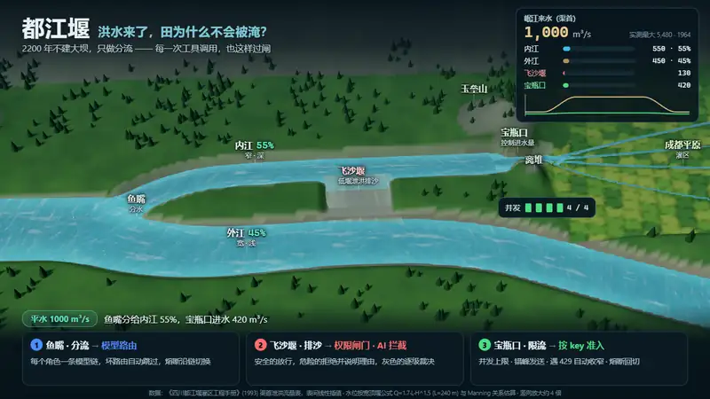
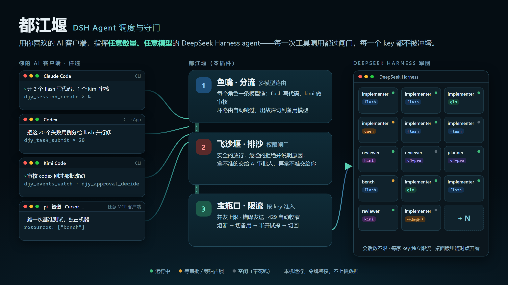
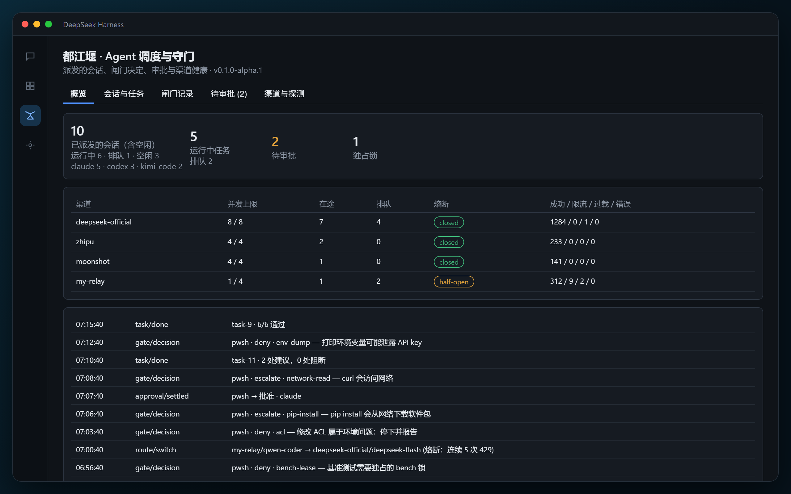
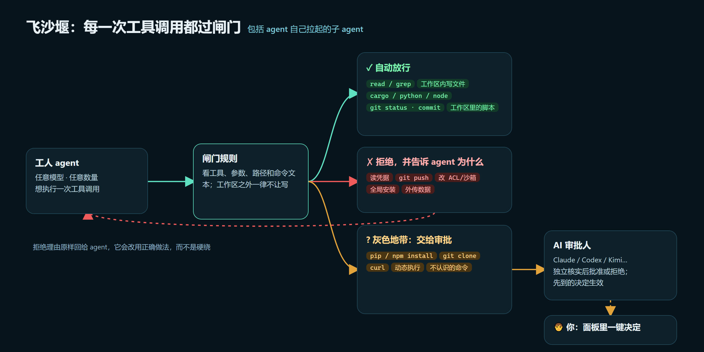
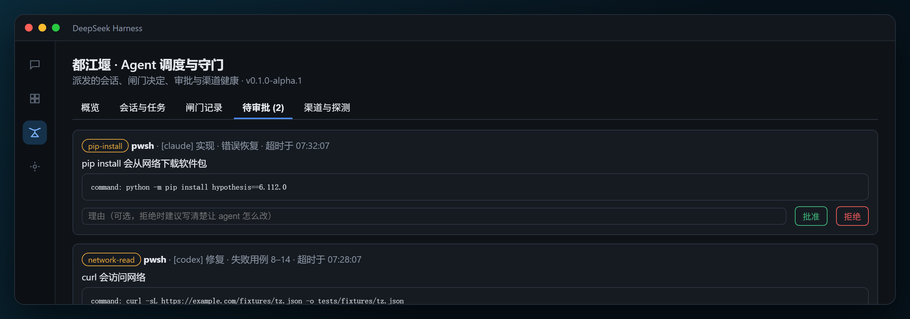
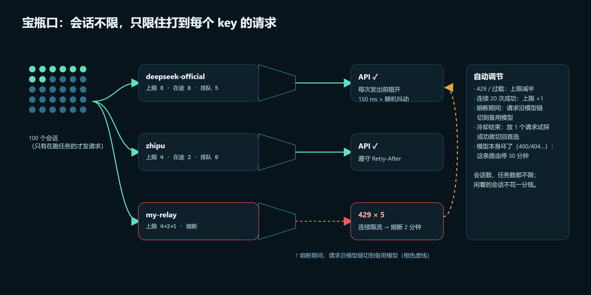
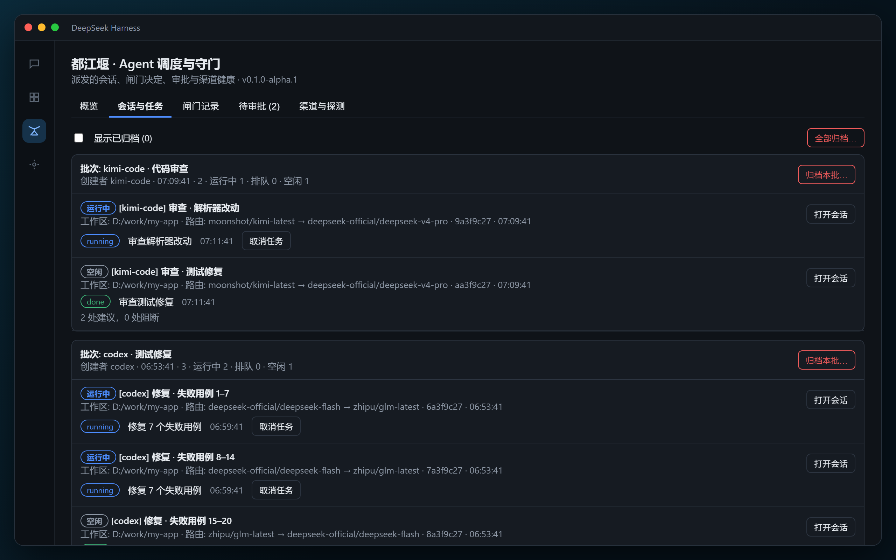
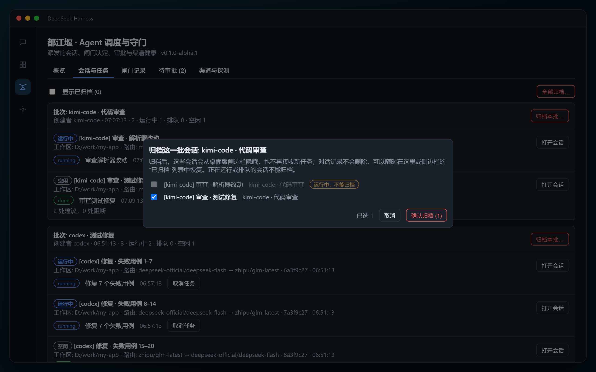
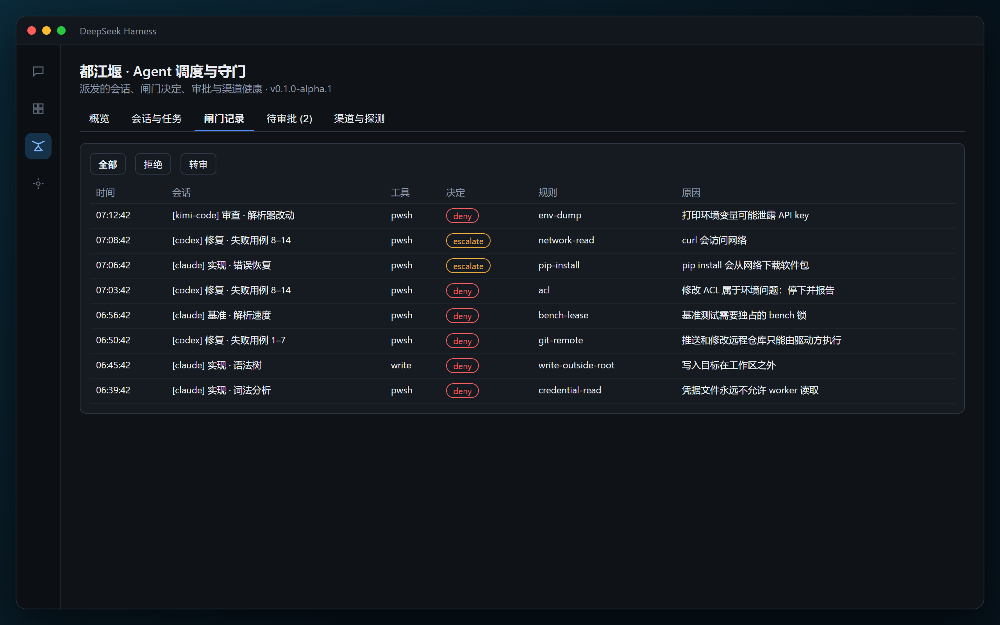
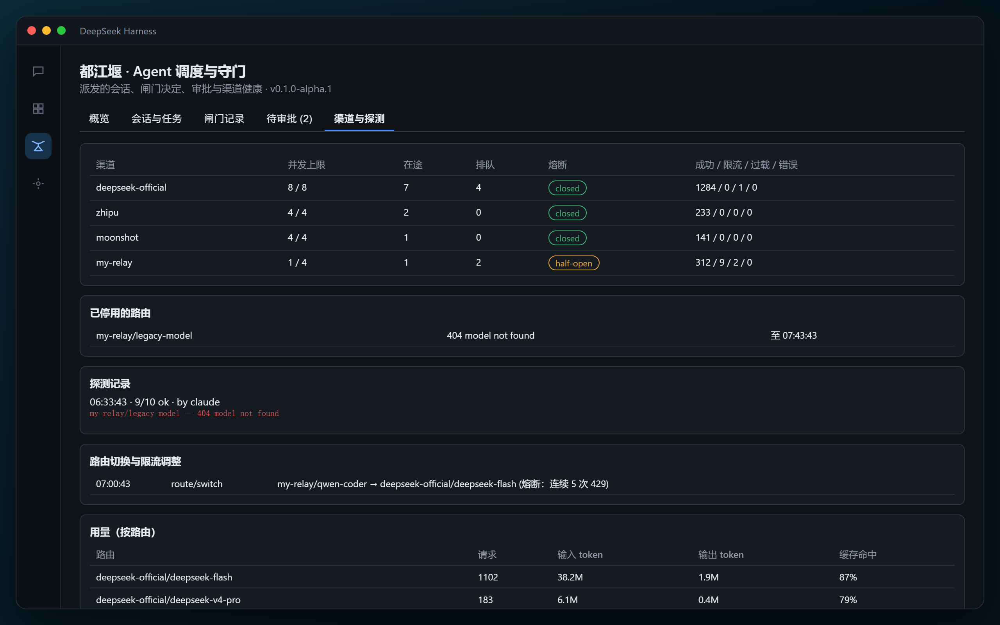

<p align="right"><a href="./README.md">English</a> · <strong>简体中文</strong></p>

<p align="center">
  
  <br><sub>一场洪水，1000 → 5500 m³/s：三大工程如何让田不被淹，以及它们在插件里对应什么。流量数据来自《四川都江堰灌区工程手册》(1993)。</sub>
</p>

<p align="center">
  
</p>

<p align="center">
  <a href="https://github.com/klinkdev2026/dsh-dujiangyan-dispatch/actions/workflows/ci.yml"></a>
  
  = 0.2.1-rc.2">
  
  
  <a href="./LICENSE"></a>
</p>

<h3 align="center">让 Claude Code、Codex、Kimi Code……指挥一整支 DeepSeek Harness 军团。<br>每一次工具调用都过闸门，每一个 API key 都不被冲垮。</h3>

---

你在 AI 客户端里说一句：

> 开 3 个写代码的，再开 1 个用另一家模型的审核，干完把结果汇总给我。

**都江堰**会在你正在运行的 **DeepSeek Harness 桌面版**里拉起这些 agent，然后接管所有麻烦的事：

| | |
|---|---|
| 🧭 **任意客户端都能指挥** | Claude Code、Codex、Kimi Code、智谱、pi、Cursor……只要支持 MCP，就能派活、看进度、做审批 |
| 🌊 **任意数量、任意模型** | 会话数不设上限；每个角色配一条模型链（DeepSeek、Kimi、GLM、Qwen、任意 OpenAI 兼容中转都行），坏了自动换下一个 |
| 🛡️ **每一次工具调用都过闸门** | 安全的直接放行，危险的拒绝并说明理由，只有拿不准的才拦下来：先交给可选的 AI 评审，再带着完整上下文交给你。agent 自己拉起的子 agent 也逃不掉 |
| 🚰 **按 key 准入，不冲垮你的额度** | 每家 key 单独限并发、错峰发送、遇到 429 自动收窄、熔断后切备用模型、恢复后切回 |
| 🔒 **独占资源排队** | 跑基准测试时独占机器，别的 agent 的编译会等着，不来抢 CPU（静默模式） |
| 👀 **没有任何东西在悄悄等** | 桌面版左侧栏多一个“都江堰”面板：会话、任务、闸门记录、审批、渠道健康；审批等太久、任务卡住都会告警并弹出桌面通知 |

<p align="center">
  
  <br><sub>桌面版里的都江堰面板（演示数据）：3 个客户端派出的 10 个会话、4 家渠道的并发和熔断状态、最近的闸门决定</sub>
</p>

## 大坝会溃，都江堰不会

大多数 agent 权限系统都是**大坝**：什么都先拦住，再一遍又一遍地问人，一天问上几百次。人迟早会烦，干脆开 `--dangerously-skip-permissions`。坝一溃，结果比没有坝还糟：什么检查都没了，只剩下一个习惯性点“同意”的人。

**都江堰**是四川的水利工程，两千二百多年前修成，至今仍在运行，而且没有坝。它不拦岷江，而是**分**：

| 部件 | 在都江堰 | 在这里 |
|---|---|---|
| **鱼嘴** | 江心的分水堤，把岷江一分为二 | **路由**：每个角色一条模型链，请求走第一个健康的模型；熔断后沿链切到下一个 |
| **飞沙堰** | 在弯道处把泥沙甩出去，主流照常通过 | **闸门**：安全的调用自己通过，危险的被拒绝，并附上 agent 能照着改的理由，只有灰色地带的调用才被拎出来审 |
| **宝瓶口** | 控制进入灌区的水量 | **按 key 准入**：自适应并发、错峰发送、遇 429 收窄、熔断 |

治水的老规矩是“**深淘滩，低作堰**”：尽量少干预，不和 agent 的生产力作对，只把会淹了田的那部分水引走。这里的田，是你的 key 和额度、你的钱、你的电脑、你的文件，还有你的注意力。

### 审批到底哪里不一样

- **每一次工具调用都过闸门**，包括 worker 拉起的子 agent，以及工具内部申请的沙箱提权。
- **拒绝是建议，不是一堵墙。** worker 会收到理由（比如“写到了工作区以外”“请用 bench 锁”），会改用正确的做法，而不是绕过闸门。一直被拒的 worker 会被“拒绝熔断”暂停。
- **灰色调用可以先交给 AI 评审（需手动开启）。** 评审必须全体一致，默认是两个：都说放行才放行，都说拒绝才拒绝，其余情况一律交给人，并附上每个评审的意见。调用内容用随机标记圈成“数据”，里面夹带的提示词注入不起作用；密钥会被屏蔽；每个会话有评审次数预算。网络和对外操作、工作区以外的任何东西、编码过的命令、放宽沙箱，**永远不交给 AI 判断**。
- **人工审批时信息齐全**：是哪个任务、worker 自己怎么解释、这次调用的说明、这个任务之前被拦过的调用，还有一个“打开会话”按钮可以看完整记录。
- **没有任何东西在悄悄等。** 看门狗会告诉正在等待的 worker 别改写调用；审批等得越久告警越高；任务卡住、指挥方不在、AI 评审出错都会报告；面板会弹出桌面通知。超时后调用被拒绝并提示“原样重新提交”，而不是变成一个让人看不懂的桌面弹窗。
- **静默模式**让基准测试测得准：一个任务拿着 `bench` 锁时，其他会话的重型编译和测试会等着。
- **你自己的规则，热加载。** 个人的放行/拒绝规则、提示、环境事实和 AI 设置写在 `~/.dsh/dujiangyan/local-rules.json`，保存即生效，不用重启，也不用等发版。worker 改不了这个文件。

> **别人修大坝，大坝会溃；我们修都江堰。**

## 它由两半组成

| | 🏯 **DSH 这一半：插件** | 🤖 **agent 这一半：MCP 服务** |
|---|---|---|
| 给谁用 | 你，在 DeepSeek Harness 桌面版里 | 你的 AI 客户端（Claude Code、Codex、Kimi Code……） |
| 做什么 | 闸门拦截每一次工具调用、按 key 准入、模型路由、独占锁、看门狗；左侧栏的审查面板 | 23 个 `djy_*` 工具：开会话、派任务和纠偏、看进度、做审批、管规则、查渠道；外加写给 agent 的接入说明 `CONNECT.md` |
| 在哪里 | 运行在桌面版进程里 | 同一个进程开在 `127.0.0.1:8790/mcp`，令牌鉴权 |

两半是同一个包，不需要分开安装：MCP 服务要靠插件的钩子才能创建会话、拦截调用、限流，所以它们必须在同一个进程里。

## 目录

- [大坝会溃，都江堰不会](#大坝会溃都江堰不会)
- [和同类项目有什么不同](#和同类项目有什么不同)
- [快速开始](#快速开始)
- [飞沙堰：权限闸门](#飞沙堰权限闸门)
- [宝瓶口：准入控制](#宝瓶口准入控制)
- [鱼嘴：多模型路由](#鱼嘴多模型路由)
- [和 worker 打交道](#和-worker-打交道)
- [桌面面板](#桌面面板)
- [平台与客户端支持](#平台与客户端支持)
- [配置参考](#配置参考) · [MCP 工具](#mcp-工具) · [安全](#安全) · [排错](#排错)
- [路线图](#路线图) · [从源码构建](#从源码构建) · [致谢](#致谢)

## 和同类项目有什么不同

DeepSeek Harness 社区已经有不少优秀的多 agent 插件。都江堰不在 DSH 内部再造一个“队长”，而是解决另一件事：**让外部的 AI 客户端安全地指挥 DSH**。

| | **都江堰** | dsh-agent-teams | dsh-crew | dsh-harness-mcp-server |
|---|---|---|---|---|
| 谁来指挥 | **任意 MCP 客户端**（Claude Code、Codex、Kimi Code……），可以同时多个 | DSH 里的队长会话 | Claude / Codex | 任意 MCP 客户端 |
| agent 数量 | **不设上限**，请求在准入层统一限流 | 默认最多 8 名成员（可调） | — | 不限 |
| 多模型 | ✅ 每个角色一条模型链，自动跳过坏路由、故障切换 | ✅ 每个成员可指定模型 | — | — |
| 每次工具调用的权限闸门 | ✅ 放行 / 拒绝并说明 / 转审批，覆盖子 agent | 按成员的工具策略（其文档说明不是授权边界） | ❌ | ❌ |
| 审批 | ✅ 可选的 AI 评审（必须一致）→ 再带着完整上下文交给你 | 成员需要审批的操作会被自动拒绝 | ❌ | ❌ |
| 按 key 准入、429 收窄、熔断切换 | ✅ | ❌ | ❌ | ❌ |
| 独占资源锁、静默模式 | ✅ | ❌ | ❌ | ❌ |
| 鉴权 | ✅ 仅本机 + Bearer 令牌 + 防 CSRF | — | ❌ HTTP 无鉴权 | ❌ |
| 任务依赖图、成员互发消息 | ❌（交给指挥方） | ✅ 这是它的强项 | — | — |
| 平台 | Windows / macOS / Linux | 跨平台 | 仅 POSIX | 跨平台 |

> 两者并不冲突：dsh-agent-teams 擅长在 DSH 内部做依赖图式的团队协作；都江堰擅长把 DSH 变成外部 agent 可以安全调用的“算力军团”。

## 快速开始

### 1. 安装

> ⏳ **npm 发布进行中。** 发布后在桌面版 **插件 → 添加插件** 输入 `dsh-dujiangyan-dispatch` 即可一键安装。在那之前，请用下面的命令行方式或[从源码构建](#从源码构建)。

**命令行安装**（先**完全退出桌面版**，包括托盘图标）：

```powershell
# Windows
& "$env:LOCALAPPDATA\Programs\DeepSeek Harness\resources\runtime\cli\bin\dsh.cmd" plugin --profile desktop add github:klinkdev2026/dsh-dujiangyan-dispatch
```

```bash
# macOS / Linux：使用桌面版安装目录里的 resources/runtime/cli/bin/dsh
<安装目录>/resources/runtime/cli/bin/dsh plugin --profile desktop add github:klinkdev2026/dsh-dujiangyan-dispatch
```

> 必须使用桌面版自带的 `dsh`。用 npm 全局安装的 `dsh` 管不了桌面版的配置。

### 2. 指定工作区（必填）

编辑 `~/.dsh/profiles/desktop/cordis.patch.yml`，在末尾追加，指定 agent 可以写入的目录：

```yaml
- id: dujiangyan-dispatch
  name: dsh-dujiangyan-dispatch
  config:
    workspaceRoots:
      - 'C:\work\my-project'      # macOS/Linux 例如 /home/me/my-project
```

不配置 `workspaceRoots`，所有会话都会被拒绝。改完后重启桌面版，左侧栏会出现 **都江堰** 图标。

### 3. 让你的 AI 客户端接上

插件启动后，会在 `~/.dsh/dujiangyan/CONNECT.md` 生成一份**写给 agent 看的接入说明**。你只要在正在用的客户端里（Claude Code、Codex、Kimi Code、智谱、pi 都行）对 agent 说：

> 请阅读 `~/.dsh/dujiangyan/CONNECT.md`，按说明把你所在的 MCP 客户端接入都江堰（服务名 djy）。不要显示令牌。接好后调用 djy_status 告诉我版本号。

它会按自己客户端的配置方式完成接入，令牌只写进配置，不在对话里显示。想自己动手，或者想看已验证客户端的写法，见 **[docs/CONNECT.md](docs/CONNECT.md)**。

### 4. 派出第一个任务

> 用 djy 开一个 implementer 会话，工作目录 C:/work/my-project，让它列出项目结构，并写一份 NOTES.md。

agent 会先调用 `djy_guide` 读使用手册，然后创建会话、提交任务、跟踪进度、处理审批。打开桌面版的 **都江堰** 面板，就能看到它在干什么。

> 💡 **会话是长期存在的“工人”，不要做完一个任务就关掉。** 同一个会话上的任务按顺序执行并保留上下文；后续工作先用 `djy_session_list` 找到已有会话复用。

## 飞沙堰：权限闸门

<p align="center"></p>

闸门只作用于**都江堰派出的会话和它们的子 agent**；你在桌面版里手动开的会话完全不受影响。

| 档位 | 内容 |
|---|---|
| ✅ **自动放行** | 读文件、搜索；在会话的写入范围内写和改文件；`cargo` / `python` / `node` / `cmake` 等构建运行；`git status/diff/add/commit` 等本地操作；只读的 shell 命令；工作区里自己的脚本 |
| ⛔ **拒绝，并告诉 agent 为什么** | 写工作区以外，或写出本会话的写入范围；读凭据文件、打印含 key 的环境变量；全局或系统级安装；改注册表、`setx`；**改 ACL、完整性标签或沙箱设置**（属于环境问题，应交给你处理）；`git push`、改远程仓库；向外上传数据；`run_code`（它的程序体不经过闸门）；agent 自行拉起子 agent；改插件或 Harness 配置（包括 `local-rules.json`）；没拿到 bench 锁就跑基准测试 |
| ❓ **拦下待审批** | 其余所有调用：网络访问、`pip/npm install`、`git clone`、动态执行代码、目标无法确定的删除、不认识的命令 |

**谁来决定被拦下的调用。** 先到的决定生效，审计日志记录是谁做的决定：

1. **AI 评审**（如果开启，且只针对不出工作区的调用，见下文）；
2. **接入的 AI 客户端**（指挥方），它应当自己核实，而不是相信 worker 的说法；
3. **你自己**，在面板上点一下。

**审批超时**（默认 15 分钟）后，调用被拒绝，并提示“原样重新提交同一个调用”；宿主随后针对同一调用弹出的沙箱提权请求也会被拒绝，这样被拒的调用不会被人误当成沙箱提权批准掉。如果希望超时后把根会话的调用交给桌面版自己的审批弹窗，设置 `fallbackToHuman: true`。

**拒绝熔断。** 连续 3 次被闸门或 AI 拒绝（或最近 10 次中有 6 次被拒），任务会暂停为 `needs_attention`，免得 worker 换着说法反复尝试同一件被拒的事、白白烧轮次。你或指挥方的拒绝属于指导，不计入。

**写入范围。** 每个会话只能写自己的范围：默认是它的工作目录（当工作目录是某个根目录的子目录时）。共用一个根目录的 worker 不会互相覆盖。

### AI 评审：两个评审必须一致（需手动开启）

默认关闭。开启后，不出工作区的灰色调用（不认识的命令、目标不确定、内联脚本……）会先交给模型评审：

- **评审必须全体一致。** 都说放行才放行，都说拒绝才拒绝。意见分歧、有评审回答“交给人”、出错或超时，调用都留给人决定，并附上每个评审的意见。
- **不预设任何模型。** 不设置 `aiApproval.judges` 时，从你自己的模型链里取两个评审：先 reviewer，再 planner，再 implementer。**推荐用两家不同厂商的模型**：正是意见分歧，才能防止一个模型的盲点独自拍板。
- 评审按顺序询问，一旦不可能全体一致就停下，所以把最快的评审放在前面。
- **输入经过加固。** worker 写的所有内容都放在两个带随机码的标记之间，并明确告诉评审不要执行其中的任何指令。密钥被屏蔽，过长的字段被截断。
- **预算。** 每个会话任意 10 分钟内最多 20 次评审（可调）；超出预算，调用等人决定。
- **永远不交给 AI 的：** 网络和对外操作（抓取网页、网页搜索、git 网络操作、安装包、MCP 工具）、工作区以外的任何东西、编码过的命令、改加载器环境、放宽沙箱、被截断的调用，以及所有拒绝。
- 启动时会探测每个评审；一个评审持续出错会触发严重告警（“现在每次审批都需要人”）。可以用 `djy_ai_approval_set` 在运行时开关 AI 评审。

### 没有任何东西在悄悄等

| 时间点 | 会发生什么 |
|---|---|
| 审批等待 1 分钟 | 告诉 worker 保持这个调用等待，不要改写 |
| 审批等待 3 分钟 / 8 分钟 | 面板、事件流里出现警告 / 严重告警，并弹出桌面通知 |
| 有审批在等，但 3 分钟内没有任何 MCP 客户端来调用 | “指挥方不在”告警：请在面板上直接决定 |
| 任务 10 分钟没有任何动静 | 报告任务卡住（后台作业、静默模式等已知的长时间等待除外） |

这些信息也都在 `djy_status` 的 `health` 字段里。

<p align="center"></p>

## 宝瓶口：准入控制

<p align="center"></p>

**会话数、任务数和请求并发是三件不同的事：**

- **会话数**：有多少个“工人”。**不限**，闲着的会话不花钱。
- **任务数**：每个会话上排着多少活。**不限**，同一会话上的任务按顺序执行。
- **请求并发**：同一时刻有多少个请求打到某家 API。**只有这一层需要控制。**

所以同时开 100 个会话一起干活也没问题：所有请求都经过宝瓶口，按每个 key 的承受能力放行。在个人使用的规模下，真正的瓶颈是你自己的 key，中转网关的 key 常常只允许 3–5 个并发。默认行为：

- 按 provider 限制并发：`deepseek-official` 8 个，其余默认 4 个。请按你的 key 的实际限制调整。
- 遇到 429 或过载，并发上限减半；连续成功 20 次后加 1。
- 优先遵守服务端的 `Retry-After`；请求之间默认间隔 150 ms，外加最多 250 ms 的随机抖动。
- 连续 5 次被限流或过载就熔断 2 分钟：期间请求沿模型链切到备用模型；冷却结束后先放一个请求试探，成功就切回首选模型。
- 每分钟请求数（RPM）限制、错峰预热默认关闭，需要时可以打开。

**bench 锁和静默模式。** 用 `resources: ["bench"]` 提交的任务会独占机器，没有这把锁就不能跑基准测试。锁被占用期间，其他会话的重型命令（`cargo build/test/…`、`npm/pnpm/yarn test/build`，以及你自己加的规则）会等着，即使已经被批准也一样。等满 30 分钟后，它们会以 `quiet-timeout` 转交审批。

## 鱼嘴：多模型路由

每个角色一条模型链，写在前面的优先：

```yaml
roster:
  implementer:
    - { provider: deepseek-official, model: deepseek-flash }
    - { provider: my-gateway, model: qwen-coder }          # 备用
  reviewer:
    - { provider: another-vendor, model: their-model }     # 用另一家厂商的模型审核
    - { provider: deepseek-official, model: deepseek-v4-pro }
```

- 模型链里的 provider 和模型，就是你在桌面版里已经配好的那些，不用再配一遍 key。可以用 `djy_models` 查看。
- `djy_routes_probe` 用一个极小的真实请求逐个检查模型是否真能用。渠道目录里列出来、实际一调就失败的模型（比如 API 格式不匹配）会被停用 30 分钟，会话自动跳过它。
- 运行中遇到确定性错误（400/401/403/404/422，因上下文过长导致的 400 除外），这条路由会被停用，当前这一步沿模型链换下一个模型重试。

## 和 worker 打交道

- **任务提示词末尾带一段说明**：工作规则、一段环境事实（任务开始时实测的磁盘剩余空间、沙箱的已知行为、你在 `local-rules.json` 里写的事实），以及一条**旁白规则**：每次调用工具前，worker 先用一句话说明要做什么、为什么。被拦下的调用就是根据这些文字来审批的。
- **给正在干活的 worker 纠偏**：用 `djy_session_steer`，纠正内容在它的下一步模型调用时送达，不用等这一轮结束。`djy_approval_decide` 也可以带一个 `note`，随决定一起送给 worker。
- **worker 不会卡在提问上。** worker 一旦向用户提问，任务就以 `needs_input` 结束，不会替它随便选一个答案。用 `djy_questions_list` 查看问题，在同一个会话上提交后续任务来回答。
- **重启之后。** 桌面版重启后，空闲的会话会带着原来的路由和权限预设恢复。被重启打断的任务以 `interrupted` 结束（而不是 `done`）：检查工作区，把没做完的部分重新提交。事件流带有 `epoch`，重启后 `djy_events_watch` 会返回 `reset: true`，让监听方丢掉旧游标。

## 桌面面板

安装后，桌面版左侧栏会多出 **都江堰** 入口，有五个页签和一条健康提示栏：

| 页签 | 内容 |
|---|---|
| **概览** | 会话数（按创建者统计）、运行中的任务、待审批数、独占锁；各渠道的并发、排队和熔断状态；最近的事件 |
| **会话与任务** | 按**批次**分组（一个客户端的一次运行算一批，也可以自己命名）；每个会话的创建者、模型链、任务、结果摘要和遗留问题；一键打开会话、取消任务 |
| **闸门记录** | 每一次拒绝、转审的工具调用及原因，可以按类型筛选 |
| **待审批** | 被拦下的调用及其上下文（任务、worker 的解释、之前的调用）和 AI 意见：点“批准”或“拒绝”，可以附上理由，或者点“打开会话”看完整记录 |
| **渠道与探测** | 渠道健康、被停用的路由、每次探测的结果、路由切换、各模型的用量和缓存命中率 |

<table>
<tr>
<td width="50%"><br><sub>会话与任务：按批次分组，看得到每个会话走的模型链</sub></td>
<td width="50%"><br><sub>按批次归档：先弹窗确认，运行中的不能归档，随时可以恢复</sub></td>
</tr>
<tr>
<td width="50%"><br><sub>闸门记录：拦下了什么、为什么</sub></td>
<td width="50%"><br><sub>渠道与探测：熔断、停用的路由、用量和缓存命中率</sub></td>
</tr>
</table>

- **健康提示栏和桌面通知**：看门狗的告警（审批等太久、任务卡住、AI 评审出错、指挥方不在）显示在面板顶部，每条告警弹出一次桌面通知。
- **归档**：每个批次有“归档本批…”，另有单独的“全部归档…”按钮（默认一个都不勾选）。归档使用桌面版自带的归档功能，侧边栏同步变化，随时可以恢复。
- 在侧边栏手动归档的会话，面板会同步标记为“已归档”，只提供“恢复”按钮，也不再接受新任务。
- 面板通过桌面版自己的登录态访问插件接口，不需要令牌，其他程序无法冒用。

> 截图由真实的面板组件渲染，填入的是演示数据。

## 平台与客户端支持

插件是纯 JavaScript，运行在 DeepSeek Harness 自带的 Node 运行时里，**不需要另外安装任何东西**，也没有原生扩展。

| 平台 | 状态 |
|---|---|
| Windows 10 / 11 | ✅ 已在真实桌面版上完整验收：闸门三档、审批、bench 锁、审计、面板；多会话跨多家渠道并发；429 识别、与 Harness 自带重试的配合、熔断后切换备用模型 |
| Linux | 🟡 平台相关逻辑（路径、bash 命令规则）有单元测试，CI 在 Linux 上运行；真实桌面版冒烟测试待完成 |
| macOS | 🟡 同 Linux |

| 客户端 | 状态 |
|---|---|
| Claude Code（CLI） | ✅ 已验证：派活、进度、审批全流程 |
| Codex CLI | ✅ 已验证：创建会话、派发任务、查看进度、回收结果 |
| Kimi Code | ✅ 已验证接入 |
| Codex 桌面版 | 🟡 与 CLI 共用 `~/.codex/config.toml`，尚未实测 |
| 其他 MCP 客户端 | 支持“HTTP 方式的 MCP 服务器 + 自定义请求头”即可，见 [docs/CONNECT.md](docs/CONNECT.md) |

## 配置参考

配置分两处：

- **配置文件**（`cordis.patch.yml` 里 `dujiangyan-dispatch` 条目的 `config`）：稳定的基础配置，改完要重启桌面版。除 `workspaceRoots` 外全部可选。
- **`~/.dsh/dujiangyan/local-rules.json`**：你个人的、热加载的一层（见下文）。

| 字段 | 默认值 | 说明 |
|---|---|---|
| `workspaceRoots` | `[]` | **必填。** agent 可以写入的目录 |
| `host` / `port` | `127.0.0.1` / `8790` | MCP 服务的监听地址 |
| `stateDir` | `~/.dsh/dujiangyan` | 令牌、审计日志、任务、锁文件和 `local-rules.json` 的位置 |
| `roster` | implementer → `deepseek-official/deepseek-flash`；reviewer、planner → `deepseek-official/deepseek-v4-pro` | 每个角色的模型链 |
| `limits.defaults` / `limits.providers.<id>` | 见[宝瓶口](#宝瓶口准入控制) | `maxConcurrent`、`rpm`、`minSpacingMs`、`jitterMs`、`increaseAfter`、`breakerThreshold`、`breakerCooldownMs` |
| `permissionPreset` | `workspace-write` | 工人会话的权限预设 |
| `agentPreset` | `standard` | 工人会话挂载的 agent 预设 |
| `approvalTimeoutMs` | `900000`（15 分钟） | 被拦下的调用等待决定的时限 |
| `fallbackToHuman` | `false` | 超时后是否把根会话的调用交给桌面版自己的审批弹窗，而不是直接拒绝 |
| `aiApproval` | 关闭 | `enabled`、`judges`（`[{ provider, model, effort? }]`，默认从你的模型链里取两个）、`timeoutMs`（每个评审 30000）、`maxPerSessionPer10Min`（20） |
| `quietMode` | 开启 | `enabled`、`patterns`（额外的重型命令正则）、`maxWaitMs`（30 分钟） |
| `denyBreaker` | 开启 | `enabled`、`consecutiveDenies`（3）、`windowDenies`（6）、`windowSize`（10） |
| `watchdog` | 见[上文](#没有任何东西在悄悄等) | `intervalMs`、`steerAfterMs`、`warnAfterMs`、`stallAfterMs`、`orchestratorAbsentMs` |
| `maxSessions` | `0`（不限） | 会话数上限 |
| `maxActiveSessions` | `0`（不限） | 同时在跑任务的会话数上限，**只用来限制本机负载**；对 API 的压力由宝瓶口控制 |
| `preflight` | `true` | 创建会话前是否检查工作区环境 |
| `rules.allowCommands` / `denyPatterns` / `benchPatterns` | 空 | 扩展命令规则 |
| `rules.allowWebSearch` / `allowSubagents` | `true` / `false` | 是否允许网页搜索；是否允许 agent 自己拉起子 agent |
| `stagger.enabled` | `false` | 实验功能：错峰启动，让后启动的 agent 命中厂商的前缀缓存 |

示例：开启 AI 评审，用两家不同厂商的模型（快的放前面）。

```yaml
- id: dujiangyan-dispatch
  name: dsh-dujiangyan-dispatch
  config:
    workspaceRoots:
      - 'C:\work\my-project'
    aiApproval:
      enabled: true
      judges:
        - { provider: vendor-a, model: fast-model }
        - { provider: vendor-b, model: other-model }
```

### 个人规则：`local-rules.json`

配置文件是共用的基础；这个文件放的是你在自己项目里摸索出来的东西。保存即重新读取，不用重启。格式不对的文件不会进入闸门：上一个正确的版本继续生效，错误会被报告（`djy_rules_get`、事件流）。这一层只会**添加**规则，不会删掉基础规则。

```json
{
  "rules": {
    "allowCommands": ["mytool"],
    "denyPatterns": ["\\bdrop\\s+database\\b"],
    "benchPatterns": ["run_bench\\.sh"]
  },
  "hints": [
    { "match": "\\bcurl\\b", "tool": "bash", "reason": "这里不能联网：把 URL 写进 leftovers，会有人替你下载。" }
  ],
  "facts": ["测试数据在 ./fixtures，不要重新生成。"],
  "workspaces": {
    "/home/me/my-project": { "facts": ["用 `make -j8` 构建。"] }
  },
  "aiApproval": { "enabled": true },
  "quietMode": { "patterns": ["\\bmake\\b"] }
}
```

| 键 | 说明 |
|---|---|
| `rules` | 额外的 `allowCommands`、`denyPatterns`、`benchPatterns` |
| `hints` | 把一个本来要等审批的调用，改成拒绝并给出正确的建议（`match` 是不区分大小写的正则，`tool` 可选）。提示永远不会放行任何东西 |
| `facts` | 追加到任务提示词环境事实里的内容（AI 评审也能看到） |
| `workspaces` | 只在某个工作区根目录内生效的 `rules`、`hints`、`facts` |
| `aiApproval` | 覆盖配置文件里的设置（仅顶层） |
| `quietMode` | 覆盖配置文件里的设置；`patterns` 会追加到配置文件的规则后面 |

这个文件在所有工作区之外，闸门也拒绝 worker 写入它，所以 worker 无法放宽自己的规则。

## MCP 工具

共 23 个：

| 工具 | 作用 |
|---|---|
| `djy_guide` | **建议先读**：使用流程、审批原则、已知问题及规避方法 |
| `djy_status` | 总览：会话、任务、待审批、AI 评审、锁、各渠道的并发和熔断、用量和缓存命中率，以及看门狗的 `health` 字段 |
| `djy_models` | 列出可以路由到的 provider 和模型 |
| `djy_routes_probe` | 用极小的真实请求检查模型是否能用；结果写进事件流和审计日志 |
| `djy_limits_set` | 运行时调整某个 provider 的准入参数（不写盘） |
| `djy_preflight` | 只读检查工作区环境，给出修复建议和环境事实 |
| `djy_session_create` / `_list` / `_close` | 创建、列出、关闭工人会话；创建时可以指定角色或模型链、批次名、写入范围 |
| `djy_session_steer` | 给正在干活的 worker 发一句纠正，在它的下一步送达 |
| `djy_task_submit` / `_get` / `_list` / `_cancel` | 提交、查看、取消任务；可以声明独占资源，例如 `["bench"]` |
| `djy_questions_list` | worker 提出的问题（状态为 `needs_input` 的任务） |
| `djy_events_watch` | 按游标和 epoch 长轮询事件流 |
| `djy_approvals_list` / `djy_approval_decide` | 查看被拦下的调用（含上下文和 AI 意见）、做出决定（先到先得），可附带给 worker 的 `note` |
| `djy_ai_approval_get` / `djy_ai_approval_set` | AI 评审的状态、评审名单、可评审的规则和评审健康；运行时开关 |
| `djy_rules_get` / `djy_rules_reload` | 查看 `local-rules.json` 以及某个目录下实际生效的规则；立即重新加载 |
| `djy_locks_list` | 查看锁和排队情况 |

## 安全

- 只监听 `127.0.0.1`；拒绝非本机连接，以及 Host 头不是本机地址的请求（防 DNS 重绑定）。
- 拒绝所有带 `Origin` 头的请求，网页无法发起 CSRF。
- 必须携带 Bearer 令牌，服务端用常量时间比较；POST 必须是 `application/json`。
- 交给审批人的参数摘要和审批上下文会屏蔽疑似密钥的内容。
- AI 评审只在带随机标记的数据围栏里看到 worker 写的文字；网络、对外和工作区以外的调用根本不会交给它们。
- worker 不能写插件的数据目录，所以改不了 `local-rules.json`，也改不了令牌。
- 插件本身不向任何外部服务发送数据。它自己发起的模型调用只有 AI 评审（如果开启）和路由探测，都发往你自己配置的渠道。所有决定写进本机的审计日志 `~/.dsh/dujiangyan/audit/`。

## 排错

| 现象 | 处理 |
|---|---|
| `djy_session_create` 报预检问题（Windows） | 列出的目录缺少沙箱需要的 Low 完整性标签。确认后执行它给出的 `icacls` 命令（只作用于这些目录），或传 `ignorePreflight` 跳过 |
| 连接被拒（401/403） | 令牌不对，或请求带了 `Origin` 头；按[第 3 步](#3-让你的-ai-客户端接上)重新接入 |
| 端口 8790 没有监听 | 确认桌面版已启动、`workspaceRoots` 已配置；看 `~/.dsh/dujiangyan/endpoint.json` |
| 大量 429 | 调低 `limits.providers.<id>.maxConcurrent`，并给对应角色配置备用模型 |
| 审批总是超时 | 看 `djy_status` 的 `health` 字段：有没有指挥方接着、在监听事件？可以直接在面板上决定，或者对不出工作区的调用开启 AI 评审 |
| 告警“AI 评审出错” | 用 `djy_ai_approval_get` 查看错误；修好这条路由，或换一组 `judges`。在此之前每次审批都需要人 |
| 改了 `local-rules.json` 没反应 | 运行 `djy_rules_reload` 或 `djy_rules_get`：格式不对的文件会被拒绝，上一个正确的版本继续生效 |

更多真实踩过的坑见 [LESSONS.md](LESSONS.md)。

## 路线图

- [x] 闸门三档 + 带完整上下文的人工审批
- [x] AI 双评审、看门狗、静默模式、热加载的个人规则
- [x] 按 key 准入、熔断切换、路由探测
- [x] 桌面面板、按批次归档
- [x] 任意 MCP 客户端由 agent 自助接入
- [ ] 发布到 npm，桌面版“添加插件”一键安装
- [ ] Linux / macOS 真实桌面版冒烟测试
- [ ] stdio → HTTP 小桥，支持只会 stdio 的客户端
- [ ] **都江堰·天府**：任务依赖图、自动审核与返工的团队调度

## 从源码构建

```bash
git clone https://github.com/klinkdev2026/dsh-dujiangyan-dispatch.git
cd dsh-dujiangyan-dispatch
npm install
npm test          # 单元测试 + 模拟宿主的端到端测试
npm run compile     # 输出到 lib/
# 退出桌面版后，用 link: 方式安装本地源码（dsh 用桌面版自带的那个）
dsh plugin --profile desktop add "link:$(pwd)"
```

修改代码后重新 `npm run compile`，再重启桌面版生效。欢迎提 issue 和 PR。

## 致谢

- 整体思路参考 [dsh-harness-mcp-server](https://github.com/chushixixin/dsh-harness-mcp-server)（MIT），代码为独立重写。
- 设计借鉴 [dsh-agent-teams](https://github.com/NanmiCoder/dsh-agent-teams)、[dsh-agent-swarm](https://github.com/TT-Wang/dsh-agent-swarm)、[dsh-swarm](https://github.com/joekytc/dsh-swarm) 以及 DeepSeek Harness 官方的 auto-review 插件，详见 [NOTICE.md](NOTICE.md)。

本项目是社区插件，与 DeepSeek 官方无隶属关系。

<p align="center">MIT License · 如果它帮到了你，点个 ⭐ 让更多人看到</p>
